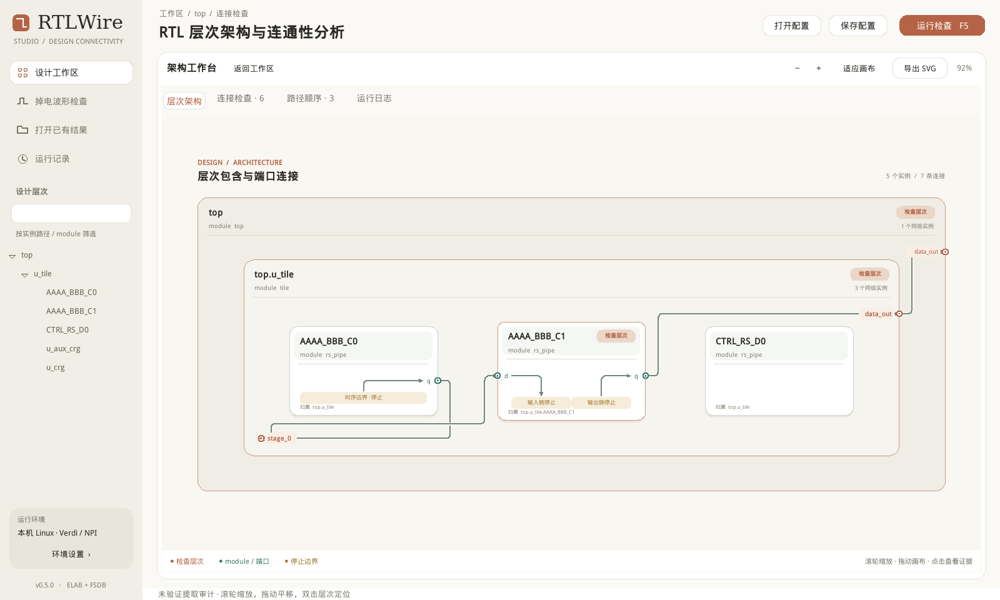
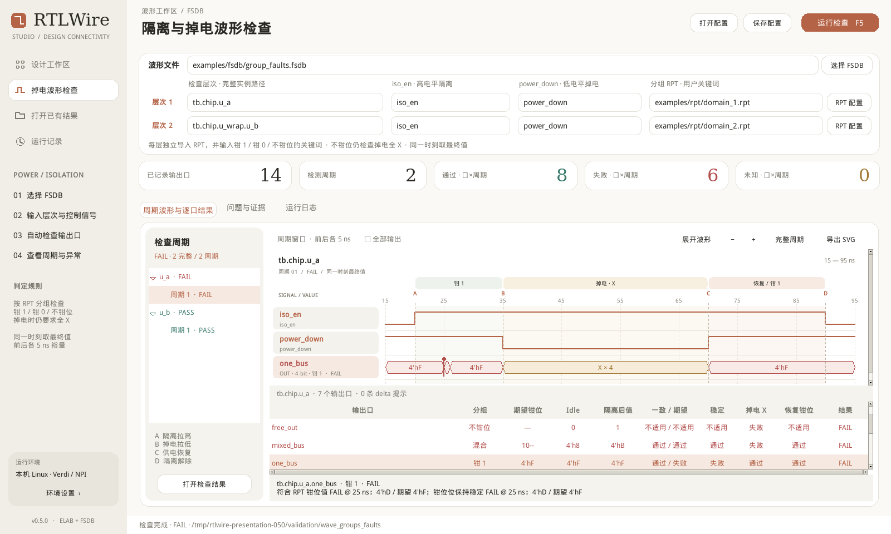

# RTLWire Studio

Linux 原生 Tk/ttk 工具：从 **Verdi 编译好的 elab 数据库**检查 RTL 连通性，从 **FSDB + 每层 RPT**检查隔离与掉电波形。当前版本 **0.5.0**。

[功能与实现原理 PPT](docs/presentations/RTLWire_Studio_Functions_and_Architecture_v0.5.0.pptx) · [PDF 预览](docs/presentations/RTLWire_Studio_Functions_and_Architecture_v0.5.0.pdf) · [RPT 分组说明](docs/rpt_groups_040.md) · [界面说明](docs/ui_refresh_050.md)



## 功能

| 工作方式 | 用户输入 | 结果 |
|---|---|---|
| 连接检查 `reach` | 已编译 elab、检查层次、module 定义名、一个或多个信号 | 递归寻找任意深度的目标实例，检查与输入/输出端口的连接，保留位覆盖和证据。 |
| 连接顺序 `trace` | elab、起始信号、层次、module、沿途关注信号 | 向负载方向列出连接分支，展示跨层次接口和已支持的组合依赖；时序或不支持的边界明确停止。 |
| 掉电波形 | FSDB、两个层次各自的 iso_en / power_down、RPT 与三个关键词 | 自动枚举 FSDB 已记录的直接 output，按钳 1 / 钳 0 / 不钳位逐位检查，显示完整周期和首个异常。 |

检查层次可以嵌套：对象归属于最近的已选祖先层次，父范围扣除另行选择的子树。架构图始终按真实父子关系绘制。



## Linux 启动

```bash
git clone https://github.com/ysyx-22040210-yudian/rtlwire-studio.git
cd rtlwire-studio
sh rtlwire-studio
```

运行要求：Python 3.6+、Tk 8.5+、Linux 图形桌面和中文字体。GUI 本身只使用 Python 标准库。

- 设计提取：本机 Verdi / NPI、有效许可证、`gcc`、`strace`、`unshare` 和 `mount`。优先使用 `VERDI_HOME`，许可证继承本机环境。只读挂载保护需要 mount namespace 权限，已在 root 环境验证；工具不会自动提权。
- 波形提取：本机 Verdi 的 FSDB Reader SDK，以及 `g++`、`gcc`、`strace`。FSDB 分支可由普通账号运行。
- 查看保存的结果无需启动 EDA 工具。仓库不包含 Verdi、厂商 SDK、elab 库或许可证；安装这些工具按本机 EDA 环境管理。

实际验证平台：CentOS 7、Python 3.6.8、Tk 8.5、Verdi O-2018.09-SP2。其他 Verdi / SDK 版本需要在本机确认兼容性。

## 快速查看与测试

```bash
# 查看保存的设计记录；点击“专注画布”，Esc 返回。
sh rtlwire-studio --result validation/reach_dual_io
sh rtlwire-studio --result validation/trace_chain

# 查看已保存的波形结果。
sh rtlwire-studio --result validation/wave_groups_faults

# 本机已加载 EDA 环境时，实际读取随附的小型 FSDB 示例。
sh rtlwire-studio --config examples/power_groups_pass.json
python3 -m rtlwire.wave_cli --query examples/power_groups_faults.json --out work/power_check

# 不依赖 EDA 的核心测试，包含架构绘图的历史图数据。
python3 -m unittest discover -s tests -p 'test_*.py'
```

设计查询示例中的 `/path/to/compiled/design.elab++` 需要改成已有编译库路径。库应包含所需的随附编译产物；缺少数据时不会回退到读取 RTL 或重新编译。

`validation/` 是经过整理的示例记录，不包含开发机原始访问日志。打开这些记录用于展示与离线测试，不等于本机已重新执行 elab 审计。FSDB 示例由独立 Writer SDK 测试程序产生，生成器在 `tests/make_wave_group_fixtures.py`。

## 波形检查规则

定义 A = iso_en↑、B = power_down↓、C = power_down↑、D = iso_en↓，要求 A < B < C < D。

| 检查项 | 钳 1 | 钳 0 | 不钳位 |
|---|---|---|---|
| A 前 idle 与 A 时刻最终值一致 | 检查 | 检查 | SKIP |
| `[A,B)` 期望钳位值 | 全 1 | 全 0 | SKIP |
| `[A,B)` 稳定性 | 检查 | 检查 | SKIP |
| `[B,C)` 掉电值 | 全 X | 全 X | **全 X** |
| `[C,D)` 恢复后的隔离值 | 全 1 | 全 0 | SKIP |

每层单独导入 RPT，例如 `GROUP_HIGH {sig_a, bus[3]}`。用户分别输入三类关键词，以组名的字面子串匹配，区分大小写。支持整总线和位/片选；重复归组、遗漏或未匹配条目会报告问题。混合总线掩码如 `10--`，`-` 为明确不钳位，掉电全 X 仍覆盖全部位。

同一时间戳按所有已记录更新中的最终值判定；保留下来的 delta 更新作为提示。显示窗口为 A 前 5 ns 至 D 后 5 ns，受实际文件范围限制。缺少完整边沿、方向、采样或 dump-off 覆盖不足时报告 UNKNOWN。

## 实现结构

```text
rtlwire/gui.py + theme.py + wave_gui.py    Tk 视图、用户输入、图表交互
rtlwire/jobs.py                          后台任务与 CLI 子进程
npi/extract.tcl                          debImport -elab 与 NPI 句柄遍历
rtlwire/core.py                          层次归属、BFS 可达性、路径枚举
rtlwire/architecture.py                  嵌套布局、正交布线、共享 SVG 图元
wave/fsdb_reader.cpp                     SDK 枚举端口、读取时间戳与四态值
rtlwire/wave_groups.py                   RPT 解析、关键词匹配、按位对账
rtlwire/wave_core.py                     周期状态机、区间规则、首个异常
rtlwire/wave_plot.py                     波形场景与 SVG
rtlwire/cli.py + wave_cli.py              运行、审计、报告与资源限制
```

## 验证与支持边界

0.5.0 开发验收包含 62 项单元测试、9 项实际 FSDB GUI 流程、6 项界面检查，以及普通账号读取只读 FSDB / RPT 的安装包验证。详见 PPT 中的验证说明。

- `reach` 为每个命中端口保留一条连接见证；`trace` 枚举已提取图中、在限制内的下游分支。`observe_signals` 是显示关注点，不是遍历白名单。
- 原始图保留真实方向。`reach` 的上游见证绘图时还原真实信号流向，混合方向见证只表示连通性。
- 模块输入到输出需要实际连接/已支持依赖证据，不会自动把所有输入、输出两两相连。默认在寄存器、锁存器等时序处停止。
- 当前组合穿越支持 Assign / Buf / Neg / And / Or / Xor / Nand；不支持或不确定的结构明确停止。未知、资源截断和部分位命中不会伪装成完整通过。
- FSDB 覆盖范围是记录了方向和值的本层直接 output。内部 net、inout、子模块端口不猜测为 output；从未 dump 的端口无法仅由 FSDB 证明存在。
- 结果不是功能等价证明，也未宣称覆盖所有 SystemVerilog / VHDL 类型或完整芯片性能。

输出包含 JSON、CSV、SVG 和检查证据。应用在 Linux 本机运行，不需要网络服务。
